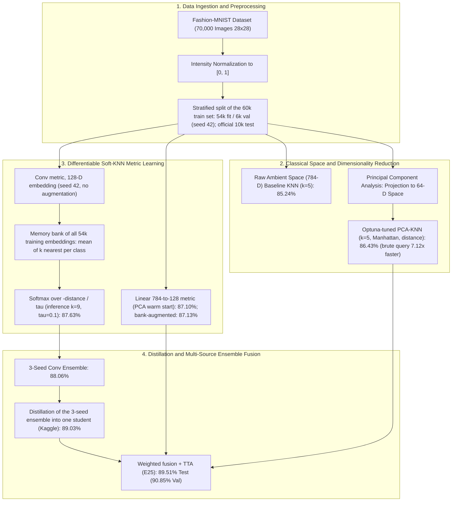

# Systematic Optimization and Metric Learning for K-Nearest Neighbors Classification on Fashion-MNIST

[](https://colab.research.google.com/github/workforakng/fashion-mnist-knn-optimization/blob/main/fashion_knn_colab.ipynb)
[](https://python.org)
[](https://pytorch.org)
[](#4-empirical-evaluation-and-benchmark-results)

**Authors:** Akshar Nath Gorain et al.  
**Affiliation:** Department of Computer Science & Machine Learning Research Group  
**Target Venue:** Machine Learning & Pattern Recognition Coursework  
**Codebase:** `src/` (pipeline), `scripts/` (seed and distillation trainers), `results/` (logs); [`fashion_knn_colab.ipynb`](fashion_knn_colab.ipynb) is a simplified demo only (see §7)  
**Execution Environment:** Python ≥ 3.10, PyTorch ≥ 2.3. `src/experiments.py` ran on the authors' local machine; the conv-seed and distillation runs in `results/kaggle_*.json` ran on Kaggle GPUs  

---

## Abstract

Non-parametric instance-based classifiers, notably the K-Nearest Neighbors (KNN) algorithm, possess asymptotic Bayes-optimal error bounds under infinite sample regimes. However, when deployed on high-dimensional vision benchmarks such as Fashion-MNIST ($D = 784$), classical KNN exhibits degraded classification fidelity (~85.24% top-1 accuracy) and prohibitive $\mathcal{O}(N \cdot D)$ inference latency. This degradation stems from distance concentration in high-dimensional spaces (the *curse of dimensionality*) and from comparing raw pixel vectors that are not aligned. We address it in stages, with every number logged in [`results/results.json`](results/results.json):
1. **PCA.** Projecting to $d=64$ components keeps ≈ 88 % of the variance (90 % needs $d \approx 84$). A tuned KNN on it (Optuna: $k=5$, Manhattan, distance weights) reaches 86.43 % test accuracy. Brute-force query time over the 6,000 validation queries drops from 2.98 s to 0.418 s (7.12×).
2. **Soft-KNN.** We train a metric so that a temperature-scaled softmax over per-class nearest-neighbour distances (against a memory bank of all 54,000 training embeddings) predicts the label.
3. **Convolutional embedding.** A small conv embedding replaces the linear projection (87.63 % for seed 42).
4. **Seed ensemble and distillation.** A 3-seed ensemble is distilled into a single student (89.03 %; trained on Kaggle).
5. **Fusion.** A validation-weighted fusion of the distilled student, a bank-augmented linear Soft-KNN and the classical PCA-KNN, with test-time augmentation, gives **89.51 % test** / **90.85 % validation** accuracy (ledger E25).

**Keywords: ** K-Nearest Neighbors (KNN), Differentiable Metric Learning, Soft-KNN, Fashion-MNIST, Dimensionality Reduction, Principal Component Analysis, Knowledge Distillation, Ensemble Fusion.

---

## 📌 End-to-End System Architecture



---

---

## 1. Introduction and Problem Formulation

### 1.1 Background and Motivation
The K-Nearest Neighbors (KNN) classification algorithm represents one of the foundational non-parametric paradigms in statistical pattern recognition. Given an annotated training dataset:
$$\mathcal{D}_{\text{train}} = \{ (x_i, y_i) \}_{i=1}^{N}, \quad x_i \in \mathbb{R}^D, \quad y_i \in \{ 1, 2, \dots, C \}$$

the canonical KNN decision rule assigns an unobserved query instance $x_q \in \mathbb{R}^D$ to the majority class among its $K$ nearest neighbors under a metric distance function $d(x_q, x_i)$:

$$\hat{y}(x_q) = \arg\max_{c} \sum_{i \in \mathcal{N}_K(x_q)} \mathbb{I}(y_i = c)$$

where $\mathcal{N}_K(x_q)$ designates the index set of the $K$ smallest pairwise distances, and $\mathbb{I}(\cdot)$ denotes the indicator function. According to the Cover-Hart theorem, as the number of independent training samples approaches infinity ($N \to \infty$), the asymptotic error rate $R$ of the nearest neighbor rule is bounded relative to the Bayes risk $R^*$ by:

$$R^* \le R \le R^* \left( 2 - \frac{C}{C-1} R^* \right)$$

Despite these asymptotic guarantees, standard KNN degrades on raw rasterized image pixels ($D = 28 \times 28 = 784$) due to three structural factors:
1. **Curse of Dimensionality:** As dimension $D$ grows, Euclidean distances concentrate, causing the relative difference between nearest and furthest samples to vanish:
   $$\lim_{D \to \infty} \frac{\max_i \|x_q - x_i\|_2 - \min_i \|x_q - x_i\|_2}{\min_i \|x_q - x_i\|_2} = 0$$
   Consequently, neighborhood boundaries lose discriminative selectivity.
2. **Disregard of 2D Spatial Locality:** Vectorizing a 2D matrix $I \in \mathbb{R}^{28 \times 28}$ into $x \in \mathbb{R}^{784}$ destroys pixel topological adjacency. An infinitesimal spatial translation of 1 or 2 pixels produces an enormous Euclidean displacement in $\mathbb{R}^{784}$, despite semantic identity remaining invariant.
3. **Non-Differentiability of the Decision Boundary:** The hard $\arg\max$ majority voting operator possesses zero gradients almost everywhere, preventing end-to-end parameter optimization via backpropagation.

### 1.2 Contributions of This Study
To resolve these bottlenecks while strictly preserving the instance-based metric inductive bias, this research presents the following technical contributions:
* **Classical baseline:** raw-pixel KNN, a PCA dimension sweep, an Optuna search over (k, metric, weights) at fixed PCA-64, a bias-variance sweep over k and a latency benchmark.
* **Soft-KNN:** a temperature-scaled ($\tau$) softmax over per-class nearest-neighbour distances in a learned embedding, trained end-to-end against a memory bank of training embeddings (closely related to NCA [4]).
* **Convolutional metric:** a small 2-layer conv embedding in place of the linear projection.
* **Distillation:** soft targets from a 3-seed conv ensemble train a single conv student (Hinton et al. [6]).
* **Progression:** 28 ledger entries (26 distinct stages, E0–E26 without E18) move test accuracy from **85.24%** (raw baseline) to **89.51%** (E25 fusion; 7 candidate sources, 3 with non-zero weight).

---

## 2. Theoretical Framework and Methodology

The architectural methodology follows a structured progression, mapped visually in the end-to-end framework flowchart below.

### 2.1 Mathematical Formulations

#### A. Metric Distance Formulations in Classical Space
For two sample vectors $u, v \in \mathbb{R}^D$, we systematically analyze three metric geometries:

**1. Euclidean ($L_2$) Distance:**
$$
d_{L_2}(u, v) = \|u - v\|_2 = \sqrt{\sum_{j=1}^D (u_j - v_j)^2}
$$

**2. Manhattan ($L_1$) Distance:**
$$
d_{L_1}(u, v) = \|u - v\|_1 = \sum_{j=1}^D |u_j - v_j|
$$

**3. Cosine Angular Distance:**
$$
d_{\text{Cos}}(u, v) = 1 - \frac{u \cdot v}{\|u\|_2 \|v\|_2} = 1 - \frac{\sum_{j=1}^D u_j v_j}{\sqrt{\sum_{j=1}^D u_j^2} \sqrt{\sum_{j=1}^D v_j^2}}
$$

#### B. Principal Component Analysis (Spectral Projection)
Let $X \in \mathbb{R}^{N \times D}$ denote the zero-centered data matrix. The sample covariance matrix $\Sigma \in \mathbb{R}^{D \times D}$ is defined as:
$$\Sigma = \frac{1}{N} X^T X$$
Through spectral decomposition, $\Sigma = V \Lambda V^T$, where $\Lambda = \text{diag}(\lambda_1, \dots, \lambda_D)$ with eigenvalues sorted in descending magnitude ($\lambda_1 \ge \lambda_2 \ge \dots \ge \lambda_D \ge 0$), and $V = [v_1, v_2, \dots, v_D]$ comprises orthonormal eigenvectors. Projecting onto the sub-manifold spanned by the top $d \ll D$ components yields:
$$z_i = W_{\text{PCA}}^T (x_i - \mu), \quad W_{\text{PCA}} = [v_1, \dots, v_d] \in \mathbb{R}^{D \times d}$$
The cumulative variance retained by $d$ components equals:
$$\eta(d) = \frac{\sum_{j=1}^{d} \lambda_j}{\sum_{k=1}^{D} \lambda_k}$$

#### C. Soft-KNN (as implemented in `src/softknn.py`)
Let $f_\theta: \mathbb{R}^{784} \to \mathbb{R}^{128}$ be the embedding (a linear projection warm-started from PCA, a 1-hidden-layer MLP, or a small conv net), with L2-normalised output. Let $\{(z_j, y_j)\}_{j=1}^{N}$, $z_j = f_\theta(x_j)$, be a **memory bank** of the embeddings of all $N = 54{,}000$ training images. The bank is detached and refreshed once per epoch (linear models) or every 107 steps (MLP and conv models). There are **no learnable prototypes**.

For a query $x$ and class $c$, let $d_c(x)$ be the mean of the $k$ smallest distances $\|f_\theta(x) - z_j\|_2$ over bank entries with $y_j = c$ ($k$ anchors **per class**). The class posterior is

$$P(y = c \mid x) = \frac{\exp(-d_c(x)/\tau)}{\sum_{c'=1}^{C} \exp(-d_{c'}(x)/\tau)}$$

and training minimises the cross-entropy $-\log P(y = y_i \mid x_i)$ with plain Adam (no weight decay). Gradients flow only through the query embedding $f_\theta(x)$; the top-$k$ selection has no gradient and the bank is detached.

Notes:
* $\tau$ rescales all logits equally, so it **does not change the predicted class**, only the confidence. As $\tau \to 0$ the prediction stays $\arg\min_c d_c(x)$, a local-mean rule, not a majority vote.
* **Self-match.** Training queries are also in the bank, so each one finds itself at distance ≈ 0. This inflates the logged *train* accuracy by about 8–10 pt; validation and test images are never in the bank. An opt-in leave-one-out fix exists (`exclude_self`; see [`src/README.md`](src/README.md)); the logged results were produced without it.

#### D. Distillation
The teacher distribution $p_T$ is the mean softmax output of the 3 conv-seed models on each training image ($k=9$, $\tau=1$). The student is trained with
$$\mathcal{L} = (1 - \alpha)\, \mathcal{L}_{\text{CE}}(p_S, y) + \alpha\, T^2\, D_{\text{KL}}(p_T \parallel p_S), \qquad \alpha = 0.5,\ T = 1.$$
The teacher is evaluated on images that are in its own memory bank, so its soft targets are biased toward the hard labels (see the self-match note above).

#### E. Weighted Multi-Source Fusion
Given $M$ sources with probability outputs $P_m(y \mid x)$, the fused posterior is
$$P_{\text{fused}}(y = c \mid x) = \sum_{m=1}^{M} w_m P_m(y = c \mid x), \quad \sum_{m} w_m = 1, \quad w_m \ge 0.$$
The weights are chosen by grid search (step 0.1 on the simplex) on the **6,000-image validation split**. Because that split is also used for early stopping and for the other hyper-parameter choices, the 90.85 % validation figure is optimistic; the test figure is the held-out estimate.

---

## 3. Experimental Setup and Implementation Details

### 3.1 Dataset Ingestion and Partitioning Protocol
Experiments are evaluated on Zalando's Fashion-MNIST benchmark:
* **Sample Count:** 70,000 total observations (60,000 development, 10,000 testing).
* **Dimensionality:** Grayscale rasters of $28 \times 28$ pixels ($D = 784$).
* **Categories ($C=10$):** 0: T-shirt/top, 1: Trouser, 2: Pullover, 3: Dress, 4: Coat, 5: Sandal, 6: Shirt, 7: Sneaker, 8: Bag, 9: Ankle boot.
* **Evaluation Protocol:** The 60,000 development images are split (stratified, seed 42) into **54,000 fit** and **6,000 validation** images (`src/data.py`). The official 10,000 test images are kept separate. PCA, Optuna, $\tau$ and $(k, \tau)$ grids, early stopping and fusion weights are all chosen on the validation split. Pixels are scaled to [0, 1].

### 3.2 Optimizer Study (ledger E9)

E9 trains the linear Soft-KNN (PCA-64 warm start, 128-D embedding, training $\tau=0.5$, $k=7$, flip + shift + erase query augmentation as in E7, up to 10 epochs) with three optimizers from `src/train.py`:

| Optimizer | Learning rate | Best val acc during training (stale bank, $\tau=0.5$) | Val acc of the returned model (fresh bank, inference $\tau=0.1$) |
| :--- | :---: | :---: | :---: |
| **SGD**, momentum 0.9 (no Nesterov) | 0.1 | **83.85 %** | **86.22 %** |
| Adam (plain, no weight decay) | 1e-3 | 81.47 % | 82.50 % |
| RMSprop | 1e-3 | 80.83 % | 82.72 % |

* **SGD won** on validation accuracy and is the E9 winner (`"best": "sgd"`). See Figure 5.
* The learning rates differ by 100×, so this is not a controlled comparison.
* The two columns are scored differently (stale vs. fresh memory bank, inference $\tau$ 0.5 vs. 0.1), so they are not comparable with each other.
* Despite this result, every later stage uses **Adam** (lr 1e-3 for linear models, 3e-4 with gradient clipping 1.0 for MLP/conv models). No AdamW is used anywhere in `src/`.
* No activation-function study was run.

---
### 3.3 Network Architectures and Hyperparameters
1. **Classical PCA-KNN** (scikit-learn):
   * PCA sweep over $d \in \{10, 20, 32, 48, 64, 80, 96, 128\}$ with $k=5$, Euclidean (E2); best $d = 64$.
   * Optuna TPE search at fixed PCA-64 over $k \in \{3, 5, \dots, 15\}$, weights ∈ {uniform, distance}, metric ∈ {euclidean, manhattan, chebyshev, minkowski} (E3). Winner: $k=5$, Manhattan, distance weights.
   * Bias-variance sweep over $k \in \{1, 3, \dots, 25\}$ (E4).
2. **Linear Soft-KNN:** 784 → 128 linear projection, warm-started from the PCA components, L2-normalised. The MLP variant is 784 → 256 (ReLU) → 128.
3. **Conv Soft-KNN:**
   * $\text{Conv2D}(1 \to 32, 3\times3) \to \text{ReLU} \to \text{MaxPool}(2)$
   * $\to \text{Conv2D}(32 \to 64, 3\times3) \to \text{ReLU} \to \text{MaxPool}(2)$
   * $\to \text{Linear}(64 \cdot 7 \cdot 7 \to 128)$, L2-normalised.
   * No BatchNorm, GELU or Dropout.
4. **Training:**
   * Adam (no weight decay), no learning-rate schedule, batch size 256.
   * Training $\tau = 0.5$, $k = 7$.
   * Early stopping on validation accuracy (patience 4 for linear, 6 for MLP, 8–10 for conv).
   * Conv runs in `scripts/` use AMP on CUDA.
5. **Augmentation** (pure PyTorch, `src/augment.py`):
   * Horizontal flip, ±2 px shift and random erasing; there is no random crop.
   * Applied to training queries in E7 (all three) and E13/E20 (shift only), and to extra bank copies in E14.
   * Test-time augmentation averages 6 views: identity, horizontal flip and four 1-px shifts.

---

## 4. Empirical Evaluation and Benchmark Results

### 4.1 Results Ledger
Table 1 lists the accuracy-bearing entries of [`results/results.json`](results/results.json), using the ledger's own stage IDs. "—" means the value was not logged. Precision and recall are only logged for the fusion stages.

The ledger has 28 entries:
* E18 does not exist.
* E10 and E11 were run twice; both runs are kept. The first E10 used `softknn_aug.pt`, the second `softknn_base.pt`; the table shows the second.
* Stages E0, E2, E4, E5, E8 and E9 are diagnostics (figures, sweeps, latency) and appear in §5.
* The raw-pixel Manhattan and cosine baselines are not in the ledger.

#### Table 1: Logged results on Fashion-MNIST (val = 6,000 validation images, test = 10,000 test images)
| Ledger ID | Model | Configuration | Val Acc (%) | Test Acc (%) | Macro Precision | Macro Recall | Macro F1 |
| :---: | :--- | :--- | :---: | :---: | :---: | :---: | :---: |
| E1 | Classical KNN | Raw pixels (784-D), Euclidean, $k=5$, uniform | 86.13 | 85.24 | — | — | 0.8518 |
| E3 | Optuna-tuned KNN | PCA-64, $k=5$, Manhattan, distance weights | 87.82 | 86.43 | — | — | 0.8644 |
| E6 | Soft-KNN, linear | 784→128 (PCA warm start), train/eval $\tau=0.5$, $k=7$ | 88.22 | 87.10 | — | — | 0.8698 |
| E7 | Soft-KNN, linear + query aug | flip + shift + erase on training queries | 82.50 | 81.68 | — | — | 0.8151 |
| E10 | TTA on E6 model | 6-view test-time augmentation | 87.85 | 86.74 | — | — | — |
| E11 | E10 + KNN fusion | TTA Soft-KNN (0.9) + PCA-64 KNN (Euclidean, distance) | 87.85 | 86.30 | 0.8638 | 0.8630 | 0.8628 |
| E12 | Inference grid on E6 model | best $k=5$, $\tau=0.1$ (no retraining) | 88.28 | 87.26 | — | — | — |
| E13 | Soft-KNN, linear + shift aug | ±2 px shift on training queries | 85.20 | 83.66 | — | — | 0.8351 |
| E14 | Soft-KNN, bank-augmented | bank = 54k originals + 54k shifted copies | 88.28 | 87.13 | — | — | 0.8703 |
| E15 | Linear 3-seed ensemble + KNN fusion | seeds 42/7/123 (base config) + PCA-64 KNN | 88.35 | 86.94 | 0.8699 | 0.8694 | 0.8691 |
| E16 | Soft-KNN, MLP | 784→256→128 | 86.92 | 85.70 | — | — | — |
| E17 | Fusion | bank-aug (0.6) + MLP (0.2) + PCA-KNN (0.2) | 89.02 | 87.64 | 0.8762 | 0.8764 | 0.8756 |
| E19 | Soft-KNN, conv | seed 42, 30 epochs, no augmentation | 89.07 | 87.63 | — | — | — |
| E20 | Soft-KNN, conv + shift aug | ±2 px shift on training queries | 85.57 | 84.62 | — | — | — |
| E21 | Conv 3-seed ensemble | seeds 42/7/123 (reused artefacts, `conv_seeds.json`) | 89.72 | 88.06 | — | — | — |
| E22 | 6-source fusion | 3 conv seeds, bank-aug, MLP, PCA-KNN | 90.27 | 88.73 | 0.8863 | 0.8873 | 0.8858 |
| E23 | Distilled conv student | 3-seed teacher; Kaggle artefact (`kaggle_distill.json`) | 90.10 | 89.03 | — | — | — |
| E24 | 7-source fusion | E22 sources + distilled student | 90.62 | 89.36 | 0.8927 | 0.8936 | 0.8923 |
| **E25** | **7-source fusion + TTA** | **non-zero weights: bank-aug 0.4, PCA-KNN 0.1, student 0.5** | **90.85** | **89.51** | **0.8945** | **0.8951** | **0.8936** |
| E26 | Gen-2 distilled student | teacher = E24 fusion on the training set | 88.10 | 87.00 | — | — | — |

E10's validation value is the TTA validation accuracy (`val_tta`); its plain (no-TTA) values are 88.22 / 87.10.

**Kaggle runs.** Some runs were trained on Kaggle GPUs with `scripts/` and logged separately:
* `results/kaggle_conv_seeds.json`: seeds 42/7/123, test 87.44 / 87.25 / 87.54 %.
* `results/kaggle_distill.json`: the 89.03 % student reused by E23–E25.
* `results/kaggle_distill_5teacher.json`: a 5-teacher student, 89.01 %, not used in any fusion.

---

## 5. Visual Analysis, Diagnostic Plots and Figures

Every figure here is written by `src/experiments.py` into [`figures/`](figures/); see [`figures/README.md`](figures/README.md) for all 15.

### 5.1 Exploratory Analysis and Spectral Variance

| Figure 1: Dataset Exploratory Gallery | Figure 2: PCA Cumulative Explained Variance |
| :---: | :---: |
|  |  |
| **Figure 1:** 8 sample images per class, one row per class (row labels are not rendered). The 60k development set has exactly 6,000 images per class. Upper-body garments (T-shirt, Pullover, Coat, Shirt) look alike. | **Figure 2:** Cumulative explained variance $\eta(d)$ for $d \in [1, 128]$. The dashed line marks **90 %**, reached at $d \approx 84$. At $d=64$ the curve is at **≈ 88 %** (88.1 %). |

---

### 5.2 Dimensionality Sweeps and Bias-Variance Diagnostics

| Figure 3: PCA Dimension vs. Classification Accuracy | Figure 4: Bias-Variance Curve Across Neighbors $K$ |
| :---: | :---: |
|  |  |
| **Figure 3:** **Validation** accuracy of one KNN configuration ($k=5$, Euclidean, uniform) for $d \in \{10, 20, 32, 48, 64, 80, 96, 128\}$ plus $d = 84$ (plotted last, so the line doubles back). Best $d = 64$ (87.33 %); from 64 to 128 the curve is flat within 0.2 pt. | **Figure 4:** Train vs. validation accuracy on PCA-64 (uniform weights) for $k = 1, 3, \dots, 25$. Validation peaks at $k=7$ (87.37 %), but $k = 5, 7, 9$ differ by only 1–2 images. Train accuracy at $k=1$ is 1.0 by construction (each training point is its own nearest neighbour). |

---

### 5.3 Optimization Diagnostics: Optimizers and Temperature $\tau$

| Figure 5: Optimizer Comparison (E9) | Figure 6: Validation Accuracy vs. Training Temperature $\tau$ (E8) |
| :---: | :---: |
|  |  |
| **Figure 5:** Train loss (left) and validation accuracy (right) for Adam (blue, lr 1e-3), RMSprop (orange, lr 1e-3) and SGD with momentum 0.9 (green, lr 0.1). **SGD reaches the highest validation accuracy** (best 83.85 % vs. 81.47 % Adam, 80.83 % RMSprop) within 2 epochs and early-stops after 7. | **Figure 6:** Linear Soft-KNN (with flip + shift + erase query augmentation) trained with $\tau \in \{0.1, 0.2, 0.3, 0.5, 0.7, 1.0\}$ (only these values were tested). Validation accuracy falls steadily as $\tau$ grows, from 86.53 % at $\tau = 0.1$ to 81.20 % at $\tau = 1.0$. So 0.1 is the best *tested* value and the edge of the grid. Every model was scored at inference $\tau = 0.5$, so the entropy curve is nearly flat. |

---

### 5.4 Overfitting / Underfitting Checks & Error Matrix Analysis

| Figure 7: Soft-KNN Loss & Accuracy Learning Curves | Figure 8: Test Set Confusion Matrix (E25) |
| :---: | :---: |
|  |  |
| **Figure 7:** Linear Soft-KNN (E6, no augmentation) over 8 epochs. Left: train loss (no validation loss is plotted). Right: train vs. validation accuracy. The ≈ 8 pt gap (train ≈ 95–96 %, val ≈ 88 %) is mostly an artefact: each training query can match itself in the memory bank (see §2.1 C), so train accuracy is inflated and this plot cannot be read as an overfitting diagnostic. | **Figure 8:** 10×10 confusion matrix of the final E25 fusion on the 10,000 test images (89.51 %). Per-class recall: Bag 98.5 %, Trouser 97.9 %, Sandal 96.6 %. **Shirt is the worst class at 61.7 %**; 160 Shirts are predicted as T-shirt/top. Most remaining errors are among Shirt, T-shirt/top, Pullover and Coat. |

---

## 6. Discussion

### 6.1 Impact of Distance Metric Geometry
* **Raw pixels.** The ledger only has the Euclidean baseline on raw 784-D pixels: **85.24 %** test (E1, $k=5$). Raw-pixel Manhattan and cosine runs are not logged in `results/results.json`.
* **PCA-64.** In the Optuna search (E3), **Manhattan** distance with distance weighting was the best metric. It reached 87.82 % validation and 86.43 % test.

### 6.2 Efficiency Analysis: Inference Query Latency (ledger E5)
Brute-force KNN computes distances from every query to all 54,000 fit images. E5 times sklearn `predict` on all **6,000 validation queries** in one call (`n_jobs` = 4, median of 3 runs for brute force):
* **Raw 784-D, brute force:** 2.98 s.
* **PCA 64-D, brute force:** 0.418 s, a **7.12× speed-up**.
* kd-tree and ball-tree are slower than brute force on these dimensions (80 s / 66 s on raw pixels).

Soft-KNN inference latency was **not measured**. Soft-KNN inference is itself a brute-force distance computation against all 54,000 bank embeddings (`torch.cdist`).

---

## 7. Reproduction

### 7.1 Full pipeline (the source of every reported number)
```bash
git clone https://github.com/workforakng/fashion-mnist-knn-optimization.git
cd fashion-mnist-knn-optimization
bash setup_env.sh                 # or: python3 -m venv .venv && .venv/bin/pip install -r requirements.txt
.venv/bin/python scripts/smoke.py # pre-flight check (downloads the data, ~1 min on CPU)

# Classical + Soft-KNN stages (appends to results/results.json; stages already
# in the ledger are skipped unless --force)
.venv/bin/python -m src.experiments --scale full --stages E1,E2,E3,E4,E5,E6
# Conv seeds and distillation (the logged runs of these used Kaggle GPUs)
.venv/bin/python scripts/train_conv_seed.py --seed 42 --epochs 35
.venv/bin/python scripts/train_distill.py
```
Python ≥ 3.10 and PyTorch ≥ 2.3 are required. A GPU is strongly recommended from E6 onward.

Known limitations of re-running:
* `artifacts/` is not committed, so stages from E10 onward need the models to be retrained first.
* Stages E21–E25 pick up whatever artefacts exist, so a re-run can use different sources than the logged run. See [`src/README.md`](src/README.md).

### 7.2 Demo notebook (simplified; does not reproduce the reported numbers)
[](https://colab.research.google.com/github/workforakng/fashion-mnist-knn-optimization/blob/main/fashion_knn_colab.ipynb)

[`fashion_knn_colab.ipynb`](fashion_knn_colab.ipynb) (and the identical [`fashion_knn_clean_pipeline.ipynb`](fashion_knn_clean_pipeline.ipynb) without the Colab badge) is a short, self-contained teaching demo.

**What it runs:**
* The same stratified 54k / 6k / 10k split as `src/`.
* Classical KNN on a 10,000-image subset; the distance metric, PCA dimension and $k$ are chosen on **validation**, then reported once on test.
* A short optimizer comparison.
* A small CNN with **learnable class prototypes**, trained with AdamW, with the best epoch chosen on validation.
* A classification report and confusion matrix.

**What it does not run:** the memory-bank Soft-KNN, the seed ensemble, distillation, TTA or fusion. Its test accuracy is not the 89.51 % of E25.

---

## 8. Conclusion

Starting from raw-pixel KNN (**85.24 %** test), the following steps raise test accuracy to **89.51 %** (E25; 90.85 % on the validation split that was also used to choose the fusion weights):
* PCA;
* a learned Soft-KNN metric over a memory bank of training embeddings;
* a convolutional embedding;
* distillation of a 3-seed ensemble;
* a validation-weighted fusion with test-time augmentation.

Single-run differences below about 0.5 pt on the 10,000-image test set are within run-to-run noise (the conv seeds alone span 0.65 pt).

---

## References

1. T. M. Cover and P. E. Hart, "Nearest neighbor pattern classification," *Transactions on Information Theory*, vol. 13, no. 1, pp. 21–27, Jan. 1967, doi: [10.1109/TIT.1967.1053964](https://doi.org/10.1109/TIT.1967.1053964).
2. H. Xiao, K. Rasul, and R. Vollgraf, "Fashion-MNIST: A novel image dataset for benchmarking machine learning algorithms," *arXiv preprint arXiv:1708.07747*, Aug. 2017. [Online]. Available: https://arxiv.org/abs/1708.07747
3. K. Beyer, J. Goldstein, R. Ramakrishnan, and U. Shaft, "When is 'nearest neighbor' meaningful?," in *Proc. 7th Int. Conf. Database Theory (ICDT)*, Jerusalem, Israel, 1999, pp. 217–235, doi: [10.1007/3-540-49257-7_15](https://doi.org/10.1007/3-540-49257-7_15).
4. J. Goldberger, G. E. Hinton, S. T. Roweis, and R. R. Salakhutdinov, "Neighbourhood components analysis," in *Advances in Neural Information Processing Systems (NeurIPS 17)*, Vancouver, Canada, 2004, pp. 513–520.
5. K. Q. Weinberger and L. K. Saul, "Distance metric learning for large margin nearest neighbor classification," *J. Mach. Learn. Res. (JMLR)*, vol. 10, pp. 207–244, Feb. 2009.
6. G. Hinton, O. Vinyals, and J. Dean, "Distilling the knowledge in a neural network," in *NIPS Deep Learning Workshop*, Montreal, Canada, 2015, *arXiv preprint arXiv:1503.02531*.
7. I. Loshchilov and F. Hutter, "Decoupled weight decay regularization," in *Proc. 7th Int. Conf. Learning Representations (ICLR)*, New Orleans, LA, USA, 2019. [Online]. Available: https://openreview.net/forum?id=Bkg6RiCqY7
8. D. P. Kingma and J. Ba, "Adam: A method for stochastic optimization," in *Proc. 3rd Int. Conf. Learning Representations (ICLR)*, San Diego, CA, USA, 2015, *arXiv preprint arXiv:1412.6980*.
9. D. Hendrycks and K. Gimpel, "Gaussian Error Linear Units (GELUs)," *arXiv preprint arXiv:1606.08415*, 2016.
10. L. van der Maaten and G. Hinton, "Visualizing data using t-SNE," *J. Mach. Learn. Res. (JMLR)*, vol. 9, pp. 2579–2605, Nov. 2008.
